# Frontend User Guide – AI CRM Platform

## 1. Introduction

The AI CRM Platform helps users discover, review, claim, and manage job leads through a simple dashboard.

This guide explains the frontend screens, their purpose, user roles, and how to use the available features.

## 2. User Roles

The platform supports four user roles:

- **Admin:** Manages and monitors the platform.
- **Researcher:** Reviews job leads and claims leads for further work.
- **Campaign Manager:** Works with campaign-related features.
- **Developer:** Accesses developer-related features and system information.

## 3. Login

**Purpose:** Allows users to access the CRM dashboard.

**How to use:**
1. Open the CRM application.
2. Enter your login details.
3. Click the Login button.
4. After successful login, the dashboard opens.

Screenshot: Login screen.

## 4. Lead Pipeline

**Purpose:** Displays available job leads collected from different sources.

**Intended users:** Researcher and Admin.

**Main information displayed:**
- Organization
- Role Title
- Source
- Experience
- Quality Score
- Status
- Assigned To
- Actions

**How to use:**
1. Open Lead Pipeline.
2. Review the available job leads.
3. Check the organization, role, experience, and quality score.
4. Click Claim to take responsibility for an unassigned lead.
5. The claimed lead becomes assigned to your account.

Screenshot: Lead Pipeline screen.

## 5. My Leads

**Purpose:** Displays the leads claimed or assigned to the logged-in user.

**Intended user:** Researcher.

**How to use:**
1. Claim an unassigned lead from Lead Pipeline.
2. Open My Leads.
3. Find the claimed lead.
4. Check its assignment status.

Example: A claimed lead can appear with the status "Assigned to You".

Screenshot: My Leads screen.

## 6. Contact Enrichment Queue

**Purpose:** Helps manage manual recruiter contact lookup tasks.

**Intended users:** Researcher and Admin.

**How to use:**
1. Open Enrichment Queue.
2. Enter a company or lead name.
3. Select a provider, such as ContactOut or Snov.io.
4. Click Add to Queue.
5. View the task under Enrichment Tasks.
6. Use Mark Completed to update its displayed status.

Note: The tested demo interface adds tasks locally. It does not perform a real provider lookup.

Screenshot: Enrichment Queue screen.

## 7. Campaign Manager

**Purpose:** Provides access to campaign-related activities.

**Intended user:** Campaign Manager.

Screenshot: Campaign Manager screen.

## 8. Suppression

**Purpose:** Provides access to suppression-related information and controls.

**Intended user:** Admin.

Screenshot: Suppression screen.

## 9. System Health

**Purpose:** Provides access to system health and status information.

**Intended users:** Admin and Developer.

Screenshot: System Health screen.

## 10. Error Center

**Purpose:** Provides access to application error information.

**Intended users:** Admin and Developer.

Screenshot: Error Center screen.

## 11. Admin

**Purpose:** Provides administration options for managing and monitoring the platform.

**Intended user:** Admin.

Screenshot: Admin screen.

## 12. Complete Lead Workflow

A Researcher can follow these steps:

1. Log in to the CRM as a Researcher.
2. Open Lead Pipeline.
3. Review available job leads.
4. Click Claim on an unassigned lead.
5. Open My Leads.
6. Verify that the claimed lead appears under the logged-in user's account.
7. Open Enrichment Queue if a manual contact lookup task is required.

## 13. Conclusion

The AI CRM frontend provides a dashboard for users to access features based on their roles. The Lead Pipeline and My Leads screens support the lead discovery and claiming workflow, while other screens provide access to campaign, enrichment, administration, and system-related features.

## 1.Admin Screenshots
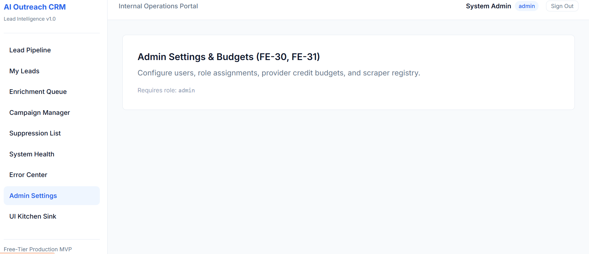
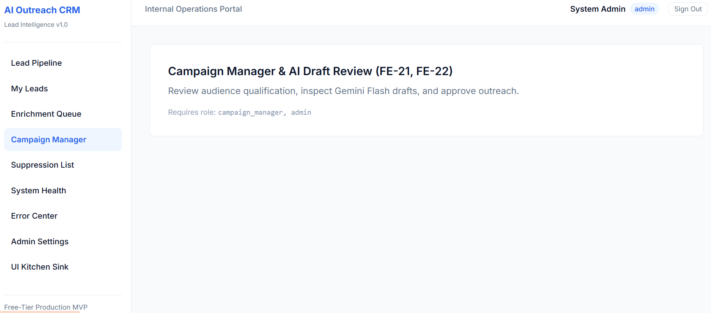 
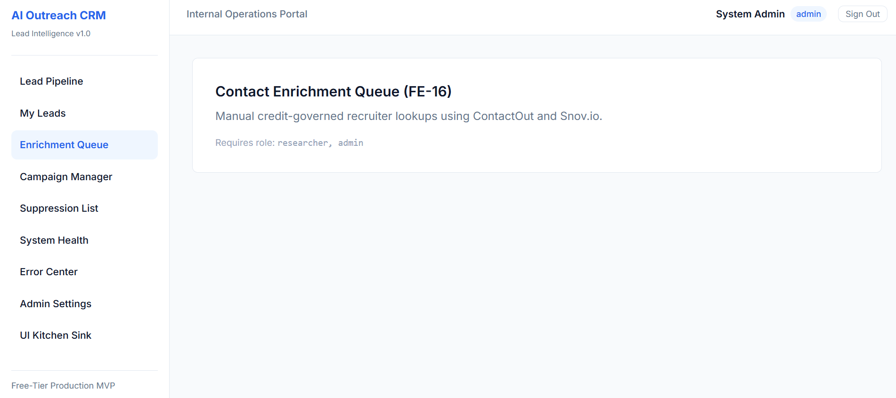 
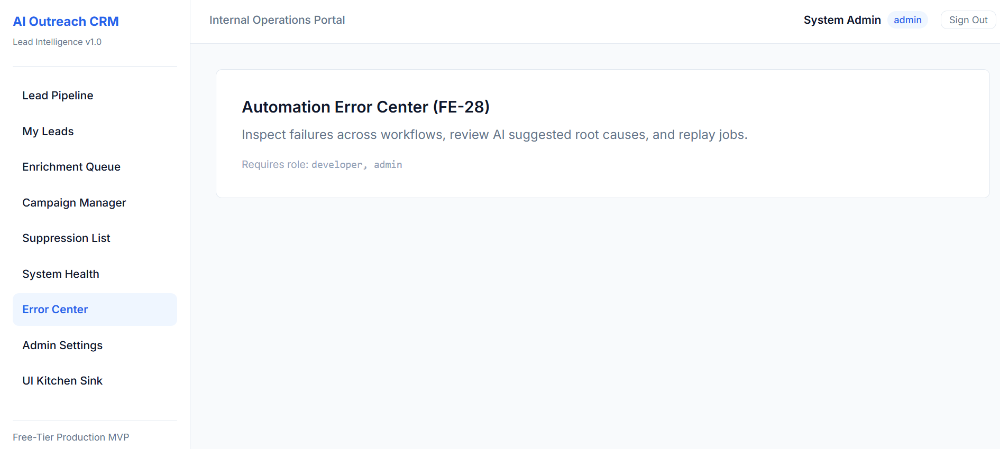 
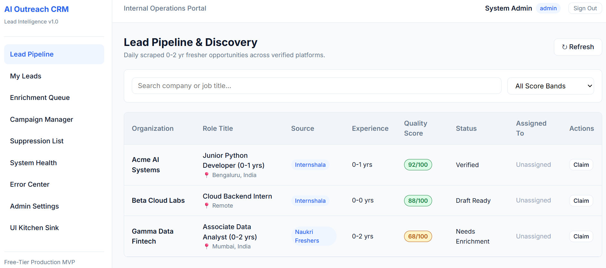 
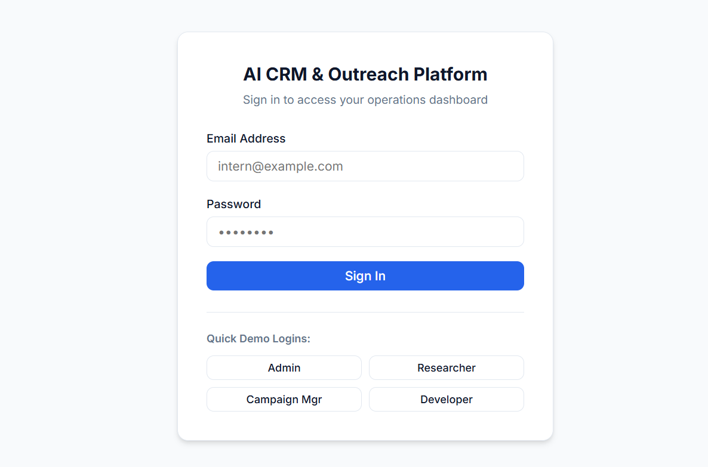 
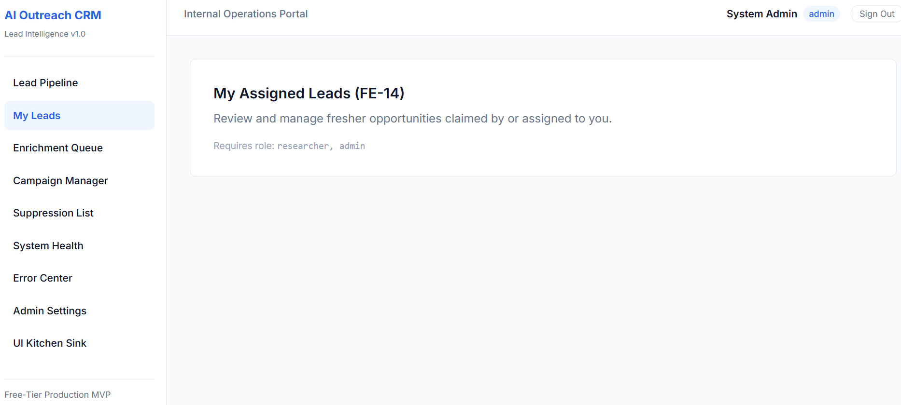 
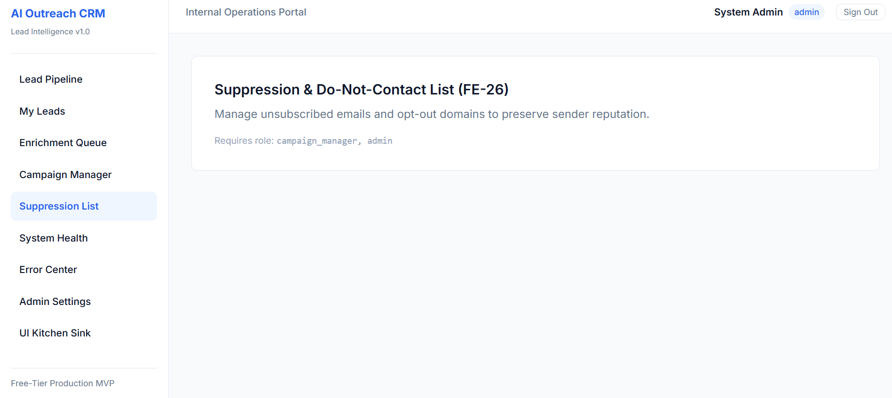 
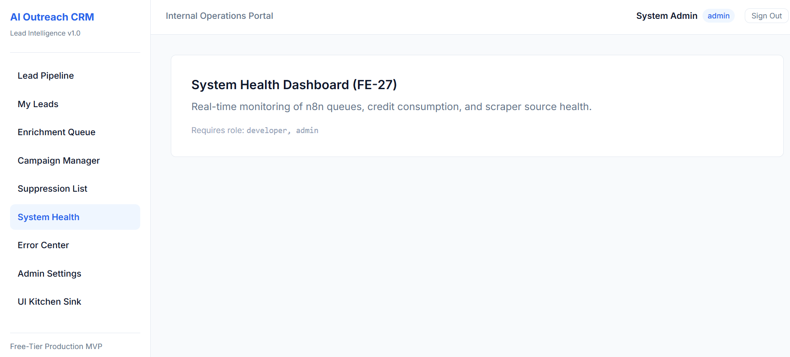

## 2.Campaign Manager Screenshots
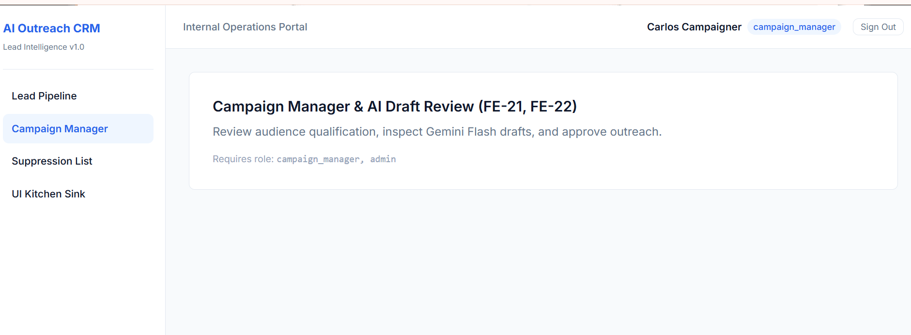 
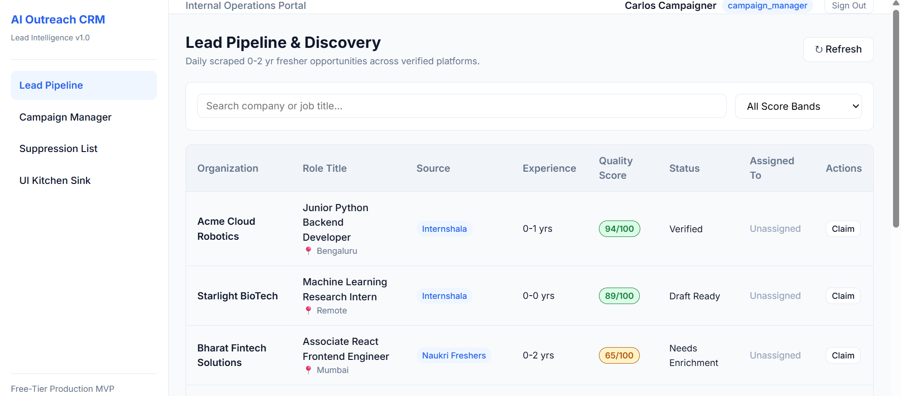 
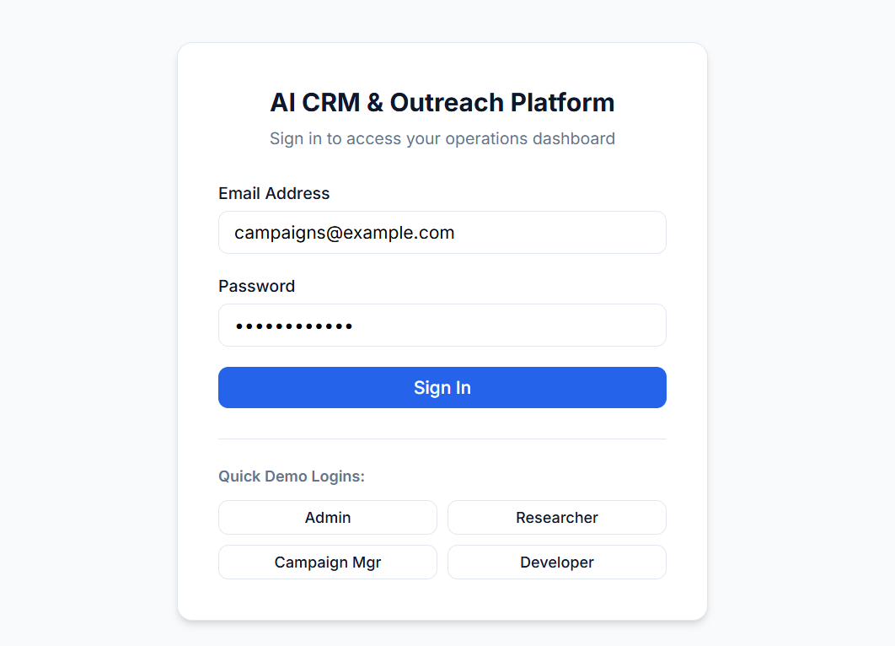 
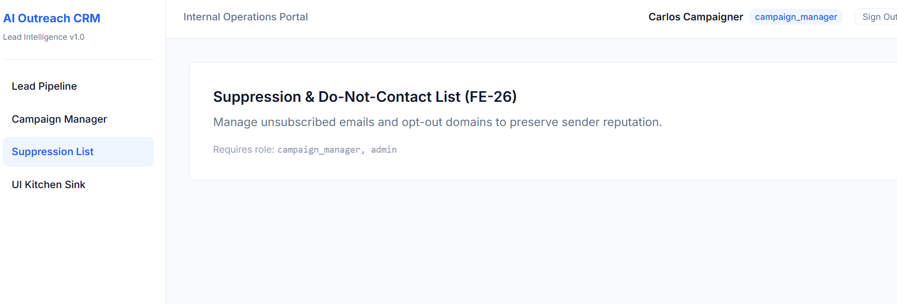

## 3.Developer Screenshots
 
 
 

## 4.Reasearcher Screenshots
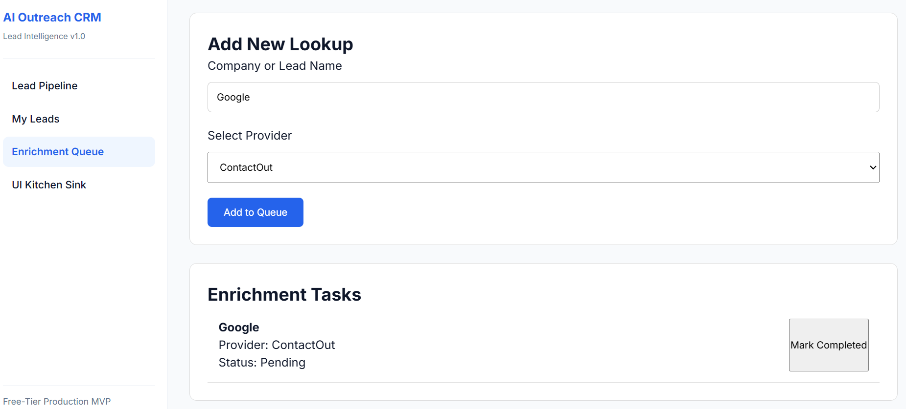 
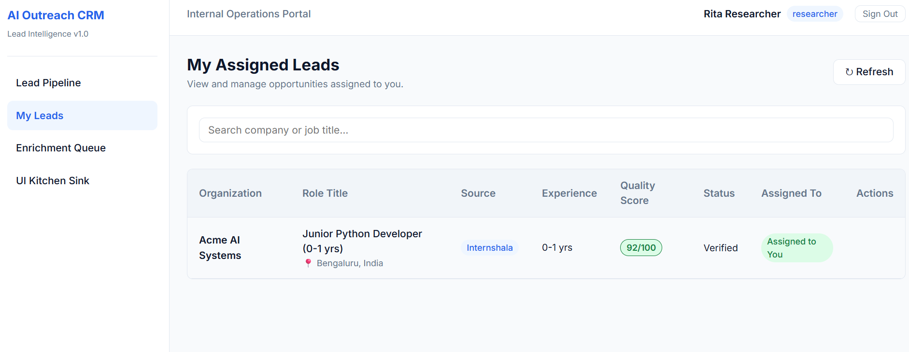 
 
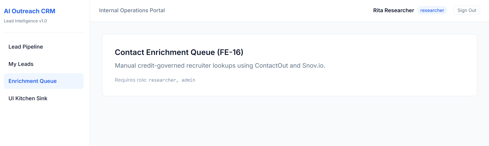 
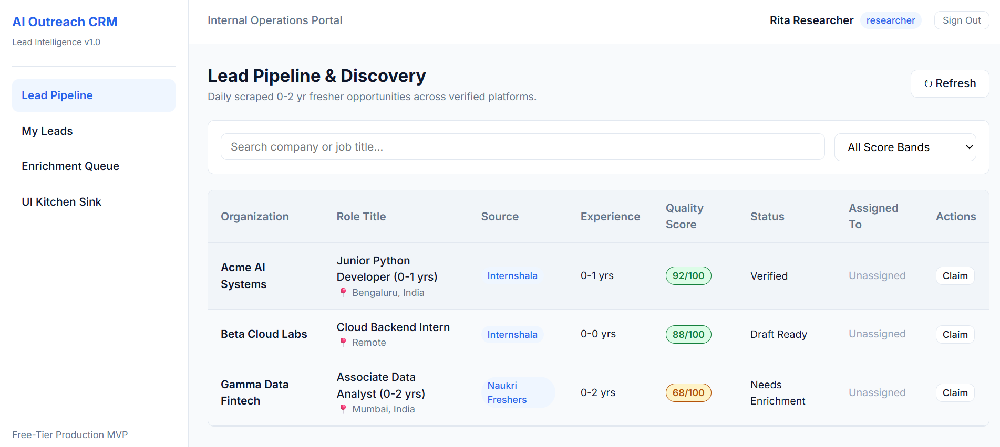 
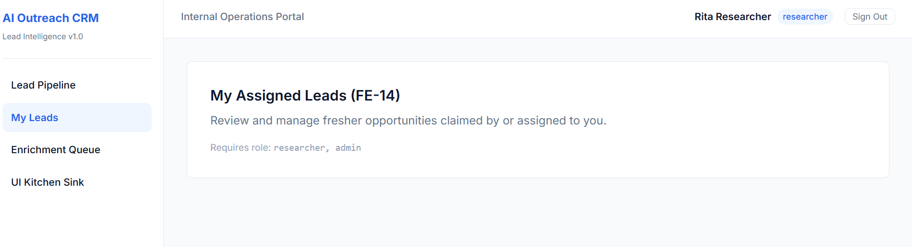
